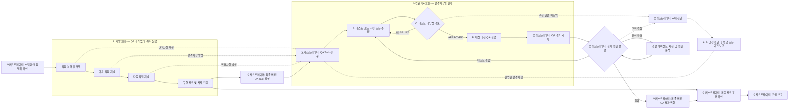

# 스펙 기반 소프트웨어 팩토리와 멀티 에이전트 워크플로우 사용

- 상태: 제안
- 작성일: 2026-10-23

## 배경

제품 스펙을 기준으로 개발하면서 구현 결과가 요구사항을 충족하는지 일관되게 확인할 필요가 있다. 하나의 에이전트가 구현과 검증을 모두 수행하면 구현 과정에서 세운 가정을 검증에서도 그대로 사용하거나, 자신이 작성한 코드에 맞춰 성공 기준을 해석할 수 있다.

검증을 별도 에이전트에 맡기더라도 테스트 통과만으로 충분한 검증이 이루어졌다고 판단하기는 어렵다. 검증 항목이 스펙의 수용 기준을 실제로 다루는지, 검증 방법과 근거가 적절한지도 검토해야 한다.

이 문서에서 소프트웨어 팩토리는 스펙을 입력으로 받아 구현, 검증, 검증 타당성 검토를 수행하고 그 결과를 중재하는 개발 방식을 의미한다. 특정 프레임워크나 실행 도구의 도입을 의미하지 않는다.

## 검토한 대안

- 단일 에이전트가 구현과 검증을 수행한다. 구성이 단순하고 실행 비용이 낮지만 구현과 검증에서 같은 오류를 놓칠 수 있다.
- 구현 에이전트와 검증 에이전트를 분리한다. 구현과 검증의 책임은 나눌 수 있지만 검증 자체의 누락이나 잘못된 판정을 확인하는 역할이 없다.
- 구현, 검증, 검증 타당성 검토를 분리하고 오케스트레이터가 중재한다. 역할별 산출물과 판단 근거를 확인할 수 있지만 실행 비용과 조정 부담이 늘어난다.

## 결정과 이유

스펙을 공통 기준으로 사용하는 세 작업 에이전트와 하나의 오케스트레이터 에이전트로 워크플로우를 구성하는 방식을 제안한다. 구현의 정확성과 검증의 타당성을 별도로 확인하기 위해 책임을 분리한다.

### 공통 입력과 판단 기준

- 작업의 기준은 [제품 스펙](../spec/README.md)에 따라 작성된 해당 기능의 스펙과 수용 기준으로 한다.
- 오케스트레이터는 작업 시작 시 대상 스펙의 버전과 작업 범위를 명시하고 모든 에이전트에 동일하게 전달한다.
- 스펙에 모호함이나 충돌이 있으면 에이전트가 임의로 요구사항을 확정하지 않는다. 오케스트레이터가 쟁점을 정리해 사용자에게 확인한다.
- 작업 중 스펙이 변경되면 영향을 받는 구현과 검증 결과를 다시 확인한다.

### 작업 분해와 범위 이탈 방지

- 오케스트레이터는 구현 에이전트 호출 시 다음 지침을 전달한다. “스펙과 수용 기준을 기준으로 작업을 검증 가능한 작은 단위로 촘촘하게 분해하고, 각 단위의 목적, 대응하는 수용 기준, 변경 대상, 완료 조건을 명시하라. 요청받지 않은 기능 추가나 관련 없는 리팩터링을 수행하지 마라.”
- 구현 에이전트는 분해한 작업 목록을 제출하고, 오케스트레이터가 요청 범위와의 대응을 확인한 뒤 구현을 진행한다. 검증 에이전트에도 같은 목록을 전달하되, 검증 기준은 원본 스펙에서 도출한다.
- 각 변경은 작업 목록의 항목에 연결한다. 목록 밖의 작업이 필요하면 이유와 영향을 오케스트레이터에 보고하고, 기존 범위 내 작업인지 확인한 뒤 진행한다. 요구사항 확장은 사용자에게 확인한다.
- 재작업에서도 같은 범위를 유지한다. 오케스트레이터는 최종 변경 내역과 작업 목록을 대조해 요청하지 않은 작업이 포함되었는지 확인한다.

### 에이전트별 책임

| 역할 | 책임 | 산출물 |
| --- | --- | --- |
| 구현 에이전트 | 작업을 분해해 스펙에 따라 구현하고, 검토 피드백의 타당성을 판단해 반영하며, 구현 완료 후 자체 검증한다. | 작업 목록, 코드 변경, 수용 기준과의 대응, 피드백 판단 근거, 자체 검증 결과 |
| 검증 에이전트(테스트 에이전트) | 변경사항별 QA Task를 받아 스펙 기반 테스트 코드를 작성하고 보완한다. C의 승인 후 대상 버전에 QA를 실행하며 실패 원인을 분석한다. | 테스트 코드, 수용 기준별 검증 방법·실행 결과·근거, 결함과 미검증 항목 |
| 검증 타당성 검토 에이전트 | 작성된 테스트 코드가 의미 있는 검증을 하는지, 비결정적 실패 가능성이 있는지 검토하고, 실행 후 근거가 판정을 뒷받침하는지 확인한다. | 테스트의 누락·오류, 보완 피드백 또는 타당 판정과 근거 |
| 오케스트레이터 에이전트 | 작업을 배정하고 산출물을 연결하며, 의견 차이와 재작업을 중재하고 완료 여부를 판단한다. | 작업 범위, 중재 근거, 재작업 지시, 최종 결과 |

검증 에이전트와 테스트 에이전트는 같은 역할을 가리킨다. 제품 코드 수정은 구현 에이전트가, 테스트 코드 작성과 수정은 검증 에이전트가 담당한다. 검증 타당성 검토 에이전트는 필요하면 핵심 검증을 재현하지만 구현 전체를 다시 수행하지 않는다.

### 테스트 타당성 검토 기준

- 각 테스트가 어떤 수용 기준을 검증하며, 해당 동작이 잘못되었을 때 실제로 실패하는지 확인한다. 단언문이 없거나 항상 참인 조건, 모의 객체의 반환값만 재확인하는 등 제품 동작을 검증하지 않는 테스트는 보완한다.
- 정상 동작뿐 아니라 스펙에 명시된 실패 조건과 경계 조건을 다루는지 확인한다. 구현 세부사항을 그대로 복제해 같은 오류를 공유하는 테스트도 검토한다.
- 외부 API 호출은 의존성 주입으로 테스트 대역을 전달할 수 있게 구현했는지 확인한다. 자동 테스트에서 실제 외부 API의 가용성, 응답 지연, 호출 제한 등에 의존해 간헐적으로 실패하지 않도록 한다. 실제 API 연동 확인이 필요하면 별도 검증으로 구분한다.
- 시간, 난수, 공유 상태, 실행 순서, 비동기 처리에 의존해 결과가 달라지는 flaky 테스트인지 검토한다. 단순 재시도로 실패를 숨기지 않고 원인을 제거한다.

### 작업 흐름

A는 구현 에이전트, B는 검증 에이전트, C는 검증 타당성 검토 에이전트다. 개발과 QA를 독립된 흐름으로 운영하며, 오케스트레이터가 변경사항을 QA Task로 전달한다. **A는 B의 테스트 작성, C의 검토, B의 QA 실행을 기다리지 않고 다음 작업의 개발을 계속한다.**

오케스트레이터는 A가 변경사항을 전달할 때마다 대상 스펙, 작업 항목, 변경 범위와 코드 버전을 명시한 QA Task를 생성해 B에 배정한다. B가 테스트 코드를 작성하면 C가 검토하고, `APPROVED` 이후 B가 해당 버전에 QA를 실행한다. 이 흐름은 A의 전체 구현 완료 전에도 반복한다. 테스트가 호출할 인터페이스와 외부 의존성 주입 경계는 A와 B에 공유하고, 변경되면 함께 갱신한다.

QA는 Task에 명시된 코드 버전을 대상으로 수행한다. A가 계속 개발하더라도 진행 중인 QA의 대상이 임의로 바뀌지 않게 하고, 이후 변경사항은 별도 Task로 전달한다. 이전 버전의 QA 통과 결과를 최신 구현의 통과로 간주하지 않는다.

C가 발견한 테스트 코드의 문제는 B가 보완하고 다시 검토받는다. 구현 관련 피드백은 오케스트레이터를 거쳐 A에 비동기로 전달한다. A는 스펙과 근거를 기준으로 타당성을 판단하고 타당한 보완을 작업 목록에 연결해 반영한다. 피드백을 수용하지 않으면 이유를 기록하고 중재를 요청하며, 미해결 피드백을 임의로 생략하지 않는다. 이 과정에서도 A는 진행 가능한 범위 내의 다른 개발 작업을 계속한다.

A는 구현 완료 시 B와 C를 기다리지 않고 자체 검증한다. 오케스트레이터는 최종 코드와 테스트 버전을 대상으로 B의 QA를 배정하고, C는 해당 테스트의 타당성과 실행 결과의 근거를 확인한다. 최종 완료 판정 시점에만 자체 검증, 최종 버전 QA, 타당성 검토 결과를 모두 취합한다. 실행하지 못한 검증은 통과로 처리하지 않는다.

실패가 발생하면 스펙, 기대값, 실행 결과를 비교해 테스트 결함과 구현 결함을 구분한다. 잘못된 기대값이나 flaky 테스트 등 테스트 자체의 결함이면 테스트를 수정하고 다시 검토한다. 스펙을 충족하지 못한 구현이면 구현을 수정한다. 둘 다 문제라면 각각 수정하며, 원인이 불분명하면 재현과 분석을 먼저 수행한다. 구현에 맞춰 기대값을 바꾸거나 테스트를 삭제해 통과시키지 않는다.

테스트 수정 후에는 C의 타당성 검토와 B의 QA 실행을 반복한다. 구현 수정은 새로운 변경사항으로 QA Task에 전달하며, A는 수정한 구현을 자체 검증한다. 변경 전 결과로 완료를 판단하지 않으며, 이 루프는 완료 조건을 충족할 때까지 진행하되 해결되지 않는 쟁점은 사용자에게 보고한다.

오케스트레이터는 다수결이나 테스트 통과 여부만으로 중재하지 않는다. 스펙의 수용 기준과 재현 가능한 근거를 기준으로 판단하고, 이견을 해소한 이유를 기록한다. 반복해도 해결되지 않는 작업은 완료로 처리하지 않고 현재 결과와 남은 쟁점을 보고한다.

### 완료 조건

- 작업 범위에 포함된 모든 수용 기준에 대해 검증 결과와 근거가 있다.
- 검증 에이전트가 해당 수용 기준의 충족을 확인하고, 검증 타당성 검토 에이전트가 그 검증을 타당하다고 판단한다.
- 해결되지 않은 결함, 검증 보완 요청, 미검증 항목이 없다.
- 구현 에이전트의 자체 검증과 검증 에이전트의 테스트 실행이 모두 통과했다.
- 최종 변경이 분해한 작업 목록과 요청 범위에 대응하며, 요청하지 않은 작업이 포함되지 않았다.
- 최종 코드 버전과 검증·검토 대상 버전이 일치하며, 오케스트레이터가 완료 판단의 근거를 정리한다.

이 워크플로우의 완료 판정은 개발 작업의 완료를 뜻한다. 병합과 배포 정책은 별도로 정한다.

## 결과 및 트레이드오프

- 스펙, 구현, 검증 근거를 연결해 요구사항의 누락과 잘못된 완료 판정을 추적하기 쉬워진다.
- 검증의 타당성을 별도로 검토하므로 테스트가 통과하더라도 검증 범위나 방법이 부적절한 경우 보완을 요구할 수 있다.
- 역할을 분리해도 에이전트가 같은 오해나 편향을 공유할 수 있다. 역할 분리 자체가 정확성을 보장하지 않으므로 스펙과 실행 근거를 함께 확인해야 한다.
- 단일 에이전트 방식보다 실행 시간, 토큰 비용, 산출물 전달 및 버전 관리 부담이 늘어난다.
- 스펙과 수용 기준의 품질이 전체 결과에 영향을 준다. 불명확한 요구사항을 코드 단계에서만 해결하려 하지 않고 스펙으로 되돌려 확인해야 한다.
- 이번 ADR은 개발 방식의 초안만 다룬다. 실행 도구, 에이전트 설정, CI 연동은 후속 작업에서 구체화한다.

## 미결정 사항

- 워크플로우를 적용할 작업의 범위와 단순 문서 수정 등 예외 기준
- 에이전트 실행 도구와 모델 구성, 작업 공간 및 컨텍스트 분리 방식
- 검증 결과와 중재 기록의 저장 위치 및 형식
- 재작업 횟수, 시간·비용 한도와 사용자에게 판단을 요청하는 구체적인 기준
- 기존 개발 절차, CI, 코드 리뷰 및 병합 정책과 연결하는 방식

## 참고 영상:

- https://www.youtube.com/watch?v=pNmfMi-yjZk
- https://www.youtube.com/watch?v=a7Mb_dJtMdk
